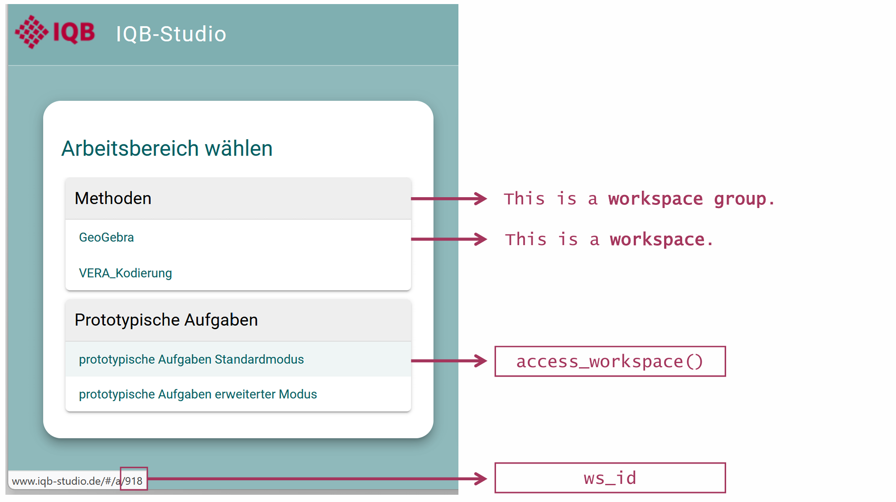
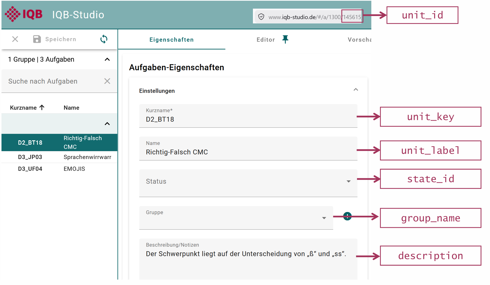
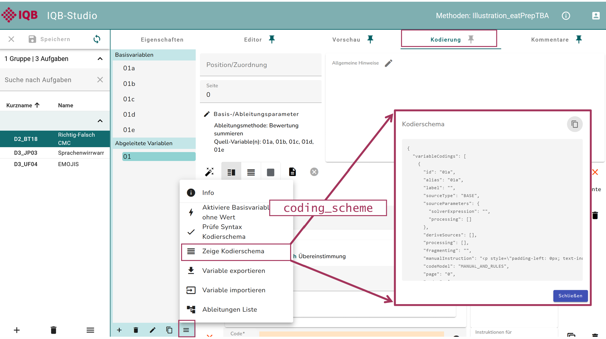
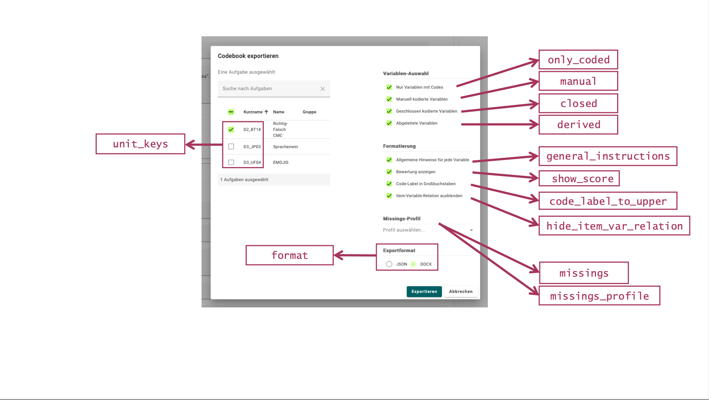
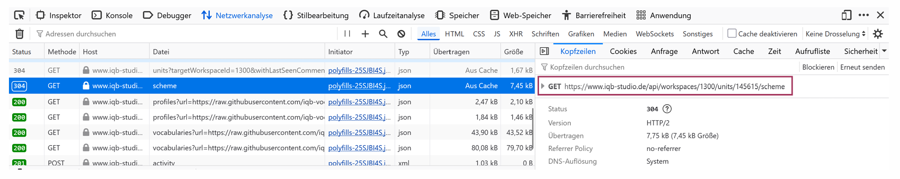

## Funktionen entlang des Workflows

| Arbeitsschritt | Funktionen |
|---|---|
| Verbindung und Workspace | [`login_studio()`](https://iqb-research.github.io/eatPrepTBA/reference/login_studio.html), [`login_testcenter()`](https://iqb-research.github.io/eatPrepTBA/reference/login_testcenter.html), [`access_workspace()`](https://iqb-research.github.io/eatPrepTBA/reference/access_workspace.html) |
| Aufgabeninformationen | [`get_units()`](https://iqb-research.github.io/eatPrepTBA/reference/get_units.html), [`add_coding_scheme()`](https://iqb-research.github.io/eatPrepTBA/reference/add_coding_scheme.html) |
| Antworten und Design | [`get_responses()`](https://iqb-research.github.io/eatPrepTBA/reference/get_responses.html), [`read_responses()`](https://iqb-research.github.io/eatPrepTBA/reference/read_responses.html), [`get_design()`](https://iqb-research.github.io/eatPrepTBA/reference/get_design.html) |
| Antworten und gespeicherte Kodierungen entpacken | [`prepare_responses()`](https://iqb-research.github.io/eatPrepTBA/reference/prepare_responses.html), [`prepare_coded()`](https://iqb-research.github.io/eatPrepTBA/reference/prepare_coded.html) |
| Kodierung | [`code_responses()`](https://iqb-research.github.io/eatPrepTBA/reference/code_responses.html) |
| Codebuch und Kodiermanual aus IQB-Studio | [`prepare_codebook()`](https://iqb-research.github.io/eatPrepTBA/reference/prepare_codebook.html), [`download_codebook()`](https://iqb-research.github.io/eatPrepTBA/reference/download_codebook.html) |
| Lokaler Excel-Export | [`writexl::write_xlsx()`](https://docs.ropensci.org/writexl/reference/write_xlsx.html) |
| Missings | [`complete_design()`](https://iqb-research.github.io/eatPrepTBA/reference/complete_design.html) |
| Missing-Überblick | [`summarise_missings()`](https://iqb-research.github.io/eatPrepTBA/reference/summarise_missings.html) |
| Item-Verknüpfung | [`add_item_id()`](https://iqb-research.github.io/eatPrepTBA/reference/add_item_id.html) |
| Psychometrische Kennwerte | [`evaluate_psychometrics()`](https://iqb-research.github.io/eatPrepTBA/reference/evaluate_psychometrics.html) |
| Log-Import und Überblick | [`get_logs()`](https://iqb-research.github.io/eatPrepTBA/reference/get_logs.html), [`read_logs()`](https://iqb-research.github.io/eatPrepTBA/reference/read_logs.html), [`summarise_log_inventory()`](https://iqb-research.github.io/eatPrepTBA/reference/summarise_log_inventory.html) |
| Log-Verlässlichkeit | [`detect_log_anomalies()`](https://iqb-research.github.io/eatPrepTBA/reference/detect_log_anomalies.html), [`summarise_log_qc()`](https://iqb-research.github.io/eatPrepTBA/reference/summarise_log_qc.html) |
| Bearbeitungs- und Ladezeiten | [`estimate_unit_times()`](https://iqb-research.github.io/eatPrepTBA/reference/estimate_unit_times.html) |
| Fokusverluste | [`summarise_log_focus()`](https://iqb-research.github.io/eatPrepTBA/reference/summarise_log_focus.html) |

[Vollständige Funktionsreferenz](https://iqb-research.github.io/eatPrepTBA/reference/index.html)

## Wiederverwendbare R-Skripte

| Datei | Inhalt |
|---|---|
| [00_installation.R](R/00_installation.R){download="00_installation.R"} | Installation, Paketversionen und Beispieldateien |
| [01_datenabruf.R](R/01_datenabruf.R){download="01_datenabruf.R"} | Daten über eigene IQB-Studio-/Testcenter-Zugänge beziehen |
| [02_daten_verstehen.R](R/02_daten_verstehen.R){download="02_daten_verstehen.R"} | JSON, Partial Credit und gespeicherte Codes |
| [03_datenaufbereitung.R](R/03_datenaufbereitung.R){download="03_datenaufbereitung.R"} | Vollständige Aufbereitung bis zum Datensatzexport |
| [04_logs.R](R/04_logs.R){download="04_logs.R"} | Überblick, Zeiten und Fokusverluste |
| [05_kodiermanuale.R](R/05_kodiermanuale.R){download="05_kodiermanuale.R"} | Lokales Codebuch als Excel und CSV |
| [06_kodiermanuale_studio.R](R/06_kodiermanuale_studio.R){download="06_kodiermanuale_studio.R"} | Codebuch und Kodiermanual aus dem eigenen IQB-Studio |

Die lokalen Skripte verwenden die Daten aus dem Materialpaket. `00_installation.R` wird abschnittsweise ausgeführt; der Installationsblock ist nur bei Bedarf erforderlich. Die erste Kodierung und ihre Prüfung gehören zum Rechenbeispiel in Skript `02`. eatAutoCode wird über `library(eatPrepTBA)` intern geladen und nicht separat mit `library()` eingebunden.

Die beiden Zugangsvorlagen enthalten Beispielangaben und werden für eigene Realdaten angepasst. Sie werden im lokalen Workshop und beim Rendern nicht ausgeführt.

## Eigene Zugänge und Fehlermeldungen

[`login_studio()`](https://iqb-research.github.io/eatPrepTBA/reference/login_studio.html) verwendet ohne `base_url` die Adresse `https://www.iqb-studio.de/`. Für eine andere Installation wird `base_url` ergänzt. `app_version` muss zur Anmeldeseite passen, einschließlich eines möglichen Beta-Zusatzes. `21.0.0`, Workspace `1300` sowie Testcenter-Workspace `35` unter `https://iqb-testcenter2.de/` sind Beispielangaben.

`keyring = TRUE` verwendet den Passwortspeicher des Betriebssystems. `keyring = FALSE` ermöglicht eine frische Eingabe; `change_key = TRUE` ersetzt zusammen mit `keyring = TRUE` die gespeicherten Zugangsdaten.

| Meldung oder Situation | Nächster Schritt |
|---|---|
| HTTP 401 Unauthorized | Adresse und Zugangsdaten prüfen; mit `keyring = FALSE` neu eingeben. Falsch gespeicherte Daten bei Bedarf mit `change_key = TRUE` ersetzen. |
| HTTP 521 | `app_version` mit der vollständigen Versionsangabe auf der IQB-Studio-Anmeldeseite abgleichen. |
| IQB-Studio wurde aktualisiert | Neu anmelden und das Workspace-Objekt erneut erstellen. |

[`get_design()`](https://iqb-research.github.io/eatPrepTBA/reference/get_design.html) berücksichtigt standardmäßig Testpersonen-Logins mit `mode = "run-hot-return"`. Bei einem anderen Testdurchführungsmodus wird `mode` ausdrücklich angegeben. Dieser Filter betrifft das Testdesign und ist kein Anmeldemodus für den Zugang zu Testcenter.

## Tabelle, Codebuch und Kodiermanual

Die lokale Lehrtabelle in `data/codebook.csv` stammt aus den synthetischen Kodierschemata und enthält eine eigene numerische `code_score`-Spalte. `R/05_kodiermanuale.R` wählt die gewünschten Units aus und schreibt die Tabelle als Excel und CSV.

Mit einem eigenen IQB-Studio-Zugang liefert [`prepare_codebook()`](https://iqb-research.github.io/eatPrepTBA/reference/prepare_codebook.html) eine aufbereitete Tabelle; [`download_codebook()`](https://iqb-research.github.io/eatPrepTBA/reference/download_codebook.html) speichert beispielsweise das originale DOCX-Kodiermanual. Die Tabellenstruktur des IQB-Studio-Exports kann von der Lehrtabelle abweichen. Optionen wie `show_score = TRUE` und `missings_profile` steuern den Inhalt des Exports. Für eigene Aufgaben die Auswahl und die enthaltenen Kodieranweisungen prüfen.

## Screenshots zum Nachsehen

Die Abbildungen stammen aus den eatPrepTBA-Vignetten am Commit `232350e`. Einige zeigen frühere IQB-Studio-Versionen; sie illustrieren die Verbindung zwischen Oberfläche und R-Begriffen. Sie sind keine Screenshots der synthetischen Studie.

### Workspace

### Unit und Kennungen

### Kodierschema

### Codebook

### API-Anfrage

## Leitfaden für eine Live-Demo

**IQB-Studio:** Workspace auswählen; eine Unit öffnen; Kurzname, Variable und Item-Verknüpfung zeigen. Auf `unit_key` und `variable_id` in R zurückverweisen.

**Testcenter:** In einem vorbereiteten Demo-Workspace Testpersonen-Datei und Booklet ansehen; die Reihenfolge zeigen; Ergebnisexport und Responses-/Logs-Dateien wiedererkennen. Ein aktueller Testcenter-Screenshot kann später ergänzt werden.

**API:** Netzwerkansicht öffnen; eine GET-Anfrage auswählen; Ressource und JSON-Antwort zeigen. Anschließend den entsprechenden Funktionsaufruf in der R-Vorlage ansehen.

## Sonderfall: Daten ohne Kodierschema

[`prepare_responses(responses)`](https://iqb-research.github.io/eatPrepTBA/reference/prepare_responses.html) entpackt Rohantworten zur eigenen Weiterverarbeitung. [`prepare_coded(responses)`](https://iqb-research.github.io/eatPrepTBA/reference/prepare_coded.html) entpackt bereits gespeicherte Kodierungen und vergibt keine neuen Codes oder Scores. Beide Wege zeigt [02_daten_verstehen.R](R/02_daten_verstehen.R) an synthetischen Dateien. Die gespeicherten Codes dienen auch als Beispiel für einen Importweg, der bei StarS-Daten relevant ist; es sind keine echten StarS-Exports.

Diese Ergebnisse sind kein direkter Ersatz für den vollständigen Workflow mit Units, Kodierschemata und Design. Insbesondere bei StarS- oder projektspezifischen Exporten Herkunft und Bedeutung der Variablen prüfen. Itemzuordnung und Missing-Regeln müssen gesondert ergänzt werden.

## Weitere Paketfunktionen zur Studienvorbereitung

[`generate_testtakers()`](https://iqb-research.github.io/eatPrepTBA/reference/generate_testtakers.html), [`generate_booklet()`](https://iqb-research.github.io/eatPrepTBA/reference/generate_booklet.html), [`generate_booklets()`](https://iqb-research.github.io/eatPrepTBA/reference/generate_booklets.html), [`prepare_booklets_from_block_design()`](https://iqb-research.github.io/eatPrepTBA/reference/prepare_booklets_from_block_design.html) und [`upload_file()`](https://iqb-research.github.io/eatPrepTBA/reference/upload_file.html) unterstützen die Studienvorbereitung. Sie gehören zum weiteren Funktionsumfang des Pakets. Für ihre praktische Anwendung wird ein eigener Testworkspace benötigt.

## Quellen

- [eatPrepTBA: Standardworkflow](https://iqb-research.github.io/eatPrepTBA/articles/standard-workflow.html)
- [eatPrepTBA: IQB-Studio-Einführung](https://iqb-research.github.io/eatPrepTBA/articles/eatPrepTBA.html)
- [eatPrepTBA: APIs](https://iqb-research.github.io/eatPrepTBA/articles/working-with-iqb-apis.html)
- [eatPrepTBA: Codebooks](https://iqb-research.github.io/eatPrepTBA/articles/prepare-codebooks.html)
- [eatPrepTBA: Log-Daten](https://iqb-research.github.io/eatPrepTBA/articles/log-data.html)
- [eatPrep-Workshop 2024 von Karoline Sachse](https://iqb-research.github.io/IQB-Methods/docs/R_tutorials/eatPrep2024_files/eatPrep2024.html)
- [Quarto: Reveal.js](https://quarto.org/docs/presentations/revealjs/)

Materialstand **24.10.2026**: eatPrepTBA **0.9.8.9042 / ea782df**, eatAutoCode **0.5.0.9008 / 54f39a8** und IQB-Autocoder **5.5.0**. `renv.lock` enthält die genaue Paketumgebung; die durchgeführten Prüfungen stehen in `VALIDATION.md`. Die öffentlich gerenderte Paketdokumentation kann zeitlich davon abweichen. Gestaltung: bereitgestellter IQB-Styleguide vom 12.01.2026, IQB-Präsentationsvorlage, originales Paketlogo und Codegestaltung nach dem eatPrep-Workshop 2024.
