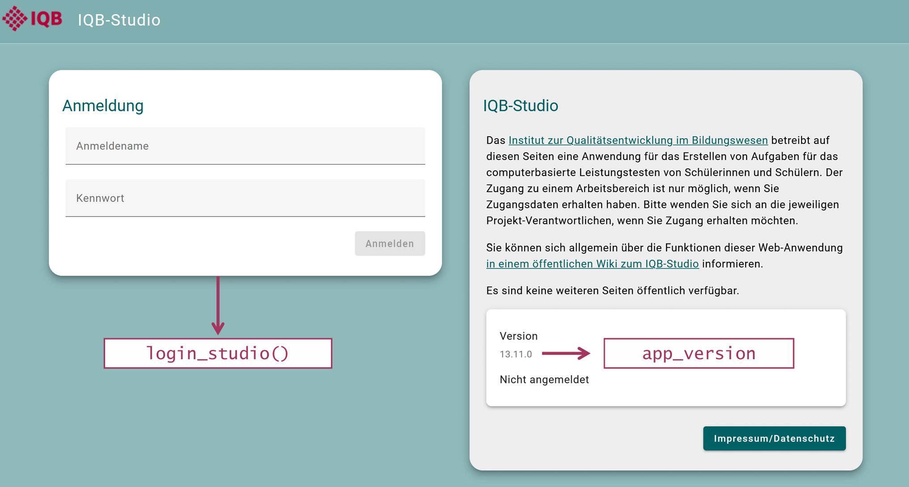
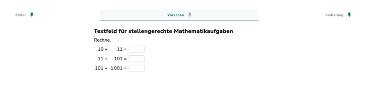
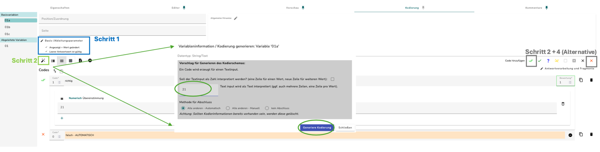
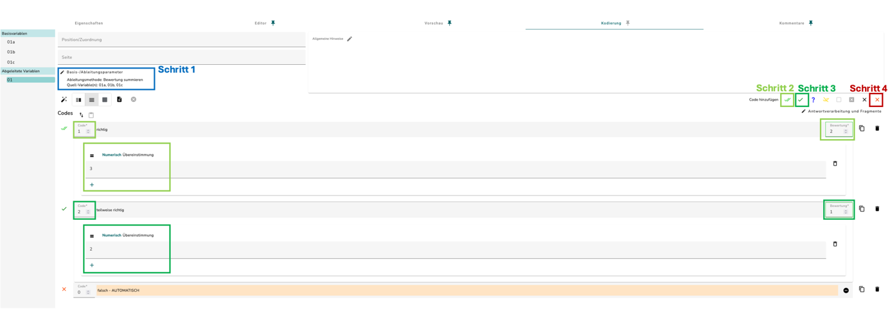

```{r}
#| include: false
#| eval: true
options(width = 82)
source("Syntaxen/02_daten_verstehen.R", encoding = "UTF-8")
source("Syntaxen/03_datenaufbereitung.R", encoding = "UTF-8")
source("Syntaxen/04_logs.R", encoding = "UTF-8")
source("Syntaxen/05_kodiermanuale.R", encoding = "UTF-8")
```

## {.hero background-image="assets/iqb-background.png" background-size="cover"}

::: {.hero-panel}
::: {.hero-layout}
::: {.hero-copy}
[IQB · Methoden-Team]{.kicker}

<h1>eatPrepTBA</h1>

[Vom Testcenter zum Skalierungsdatensatz]{.subtitle}

[Karoline Sachse · 26.10.2026]{.small}

[Aufbau des Pakets · Datenaufbereitung · Logdaten · Codebücher]{.small}
:::
{.package-logo fig-alt="Originales eatPrepTBA-Paketlogo mit Vorratsgläsern im roten Hexagon."}
:::
:::

::: notes
Materialseite und R-Projekt öffnen. Alle lokalen Beispiele funktionieren ohne IQB-Studio- oder Testcenter-Konten. Bei Bedarf gespeicherte Zwischenstände nutzen.
:::


## 0 · Einstieg {.chapter .structure-table data-nav-label="0 Einstieg"}

| Abschnitt | Inhalt |
|---|---|
| **0 · Einstieg** | Materialien, Installation und Ablauf |
| **1 · Paket und erste Kodierung** | Datenabruf, R-Objekte und Beispiel 1: Rechenaufgabe mit Teilpunkten |
| **2 · Studie und Skalierung** | Beispiel 2: manuelle Codes, Missings, Kennwerte und Skalierungsdatensatz |
| **3 · Logs und Codebücher** | Ereignisse, Zeiten, Fokusverluste und Codebuchexporte |

Nach jedem Arbeitsblock: **ca. 10 Minuten zum Ausprobieren**, anschließend Fragen.

## Materialien öffnen und herunterladen

**[sachseka.github.io/eatPrepTBAworkshop](https://sachseka.github.io/eatPrepTBAworkshop/)**

- [Folien im Browser](https://sachseka.github.io/eatPrepTBAworkshop/workshop.html) und [Handout](handout.qmd) zum Nachlesen.
- [Materialpaket herunterladen](downloads/WSeatPrepTBA-material.zip): nur **`Syntaxen/`**, **`Daten/`** und **`WSeatPrepTBA.Rproj`**.
- ZIP vollständig entpacken und **`WSeatPrepTBA.Rproj`** in RStudio öffnen.

**[00_installation.R](Syntaxen/00_installation.R)** öffnen: Pakete bei Bedarf installieren, dann laden und die Beispieldateien prüfen.

[Folien separat als PDF herunterladen](downloads/workshop.pdf)

## Materialien und Skripte {.script-table}

**Synthetische Beispieldaten** ermöglichen alle lokalen Schritte ohne eigenen Zugang.
Das [Handout](handout.qmd) enthält Code, Ausgaben und Erläuterungen.

| Datei in `Syntaxen/` | Verwendung |
|---|---|
| [00_installation.R](Syntaxen/00_installation.R) | Pakete installieren, laden und Dateien prüfen |
| [01_datenabruf.R](Syntaxen/01_datenabruf.R) | Daten aus IQB-Studio und Testcenter beziehen |
| [02_daten_verstehen.R](Syntaxen/02_daten_verstehen.R) | JSON, vorhandene Codes und Rechenaufgabe |
| [03_datenaufbereitung.R](Syntaxen/03_datenaufbereitung.R) | Vollständige Aufbereitung der kleinen Studie |
| [04_logs.R](Syntaxen/04_logs.R) | Ereignisse, Zeiten und Fokusverluste |
| [05_kodiermanuale.R](Syntaxen/05_kodiermanuale.R) | Lokales Codebuch als Excel und CSV |
| [06_kodiermanuale_studio.R](Syntaxen/06_kodiermanuale_studio.R) | Codebuch und DOCX aus IQB-Studio |

[Lokale Beispiele: 02–05. Die Vorlagen 01 und 06 benötigen eigene Zugänge.](downloads/WSeatPrepTBA-material.zip){.small}

## 1 · Paket und erste Kodierung {.chapter data-nav-label="1 Paket & Kodierung"}

**Vom Datenabruf zur ersten selbst kodierten Antwort.**

Paket und Schnittstellen kennenlernen, Antworten und Kodierschema in R ansehen und das Rechenbeispiel mit Teilpunkten kodieren.

[Skripte: 01_datenabruf.R](Syntaxen/01_datenabruf.R) · [02_daten_verstehen.R](Syntaxen/02_daten_verstehen.R)

## eatPrepTBA und eatAutoCode

::: {.columns}
::: {.column width="50%"}
{.role-logo fig-alt="eatPrepTBA-Paketlogo"}

[**eatPrepTBA**](https://iqb-research.github.io/eatPrepTBA/) bezieht Antworten und Metadaten, verbindet sie mit dem Testdesign und bereitet Auswertungen und Exporte vor.
:::
::: {.column width="50%"}
{.role-logo fig-alt="eatAutoCode-Paketlogo"}

[**eatAutoCode**](https://iqb-research.github.io/eatAutoCode/) führt den [IQB-Autocoder](https://iqb-berlin.github.io/responses/) lokal in R aus. Die Regeln und Ableitungen stammen aus dem **Kodierschema**.
:::
:::

[`eatPrepTBA::code_responses()`](https://iqb-research.github.io/eatPrepTBA/reference/code_responses.html) übergibt Antworten und Kodierschemata an eatAutoCode. Zurück kommen Werte, **Codes, Scores und Kodierstatus**.

[Im Workshop `library(eatPrepTBA)` laden; eatAutoCode wird intern mitgeladen.]{.small}

## Rückmeldungen sind ausdrücklich willkommen

**Auch kleine Unklarheiten und umständliche Schritte bitte melden.**

Unverständliche Funktionsnamen, irritierende Ausgaben, fehlende Beispiele, Fehlermeldungen oder unnötige Umwege: Jedes Feedback hilft, beide Pakete verständlicher und leichter nutzbar zu machen.

- Datenabruf und Aufbereitung: [eatPrepTBA-Issues](https://github.com/iqb-research/eatPrepTBA/issues).
- Automatische Kodierung in R: [eatAutoCode-Issues](https://github.com/iqb-research/eatAutoCode/issues).
- Zu Folien und Skripten: [Workshop-Issues](https://github.com/sachseka/eatPrepTBAworkshop/issues).

[Eine kurze Beschreibung reicht als Einstieg. Bei Fehlern helfen Paketversion, Aufruf und Fehlermeldung; vertrauliche Daten bitte weglassen.]{.small}

## Wie kommuniziert R mit den Webanwendungen?

Die **API** ist die Schnittstelle, über die R Daten aus IQB-Studio oder Testcenter anfordert.

```{mermaid}
%%| eval: true
%%| echo: false
%%| fig-width: 11
%%| fig-height: 2
flowchart LR
  R["R: eatPrepTBA + httr2"] -->|"HTTP-Anfrage: URL + Sitzungstoken"| A["API: IQB-Studio oder Testcenter"]
  A -->|"HTTP-Antwort: häufig JSON"| R
```

- **eatPrepTBA** wählt den passenden Endpunkt, etwa die Units eines Workspaces. Die Anmeldung liefert einen Sitzungstoken für weitere Anfragen.
- **[httr2](https://httr2.r-lib.org/)** sendet die HTTP-Anfragen und empfängt die Antworten.
- **eatPrepTBA** bereitet die Antwort für R auf: JSON wird zunächst zu Listen, daraus entstehen Tabellen; einige Spalten bleiben verschachtelt.

[API-Einführung: Kommunikation mit IQB-Studio und Testcenter](https://iqb-research.github.io/eatPrepTBA/articles/working-with-iqb-apis.html){.small}

## Datenquellen und Einlesefunktionen

| Quelle | Benötigte Inhalte | Funktionen |
|---|---|---|
| **IQB-Studio** | Variablen, Kodierschema, Item-Verknüpfungen, Aufgabenpositionen | [`get_units()`](https://iqb-research.github.io/eatPrepTBA/reference/get_units.html) |
| **Testcenter: Antworten** | gespeicherte Eingaben | [`get_responses()`](https://iqb-research.github.io/eatPrepTBA/reference/get_responses.html) oder [`read_responses()`](https://iqb-research.github.io/eatPrepTBA/reference/read_responses.html) |
| **Testcenter: Testdesign** | vorgesehene Personen, Booklets und Reihenfolge | [`get_design()`](https://iqb-research.github.io/eatPrepTBA/reference/get_design.html) |
| **Testcenter: Logs** | Ereignisse während der Durchführung | [`get_logs()`](https://iqb-research.github.io/eatPrepTBA/reference/get_logs.html) oder [`read_logs()`](https://iqb-research.github.io/eatPrepTBA/reference/read_logs.html) |

`get_*()` ruft Daten über die **API** ab, die Schnittstelle zur Anwendung.
`read_*()` liest vorhandene Exportdateien. Danach liegen R-Objekte vor.

[Antwort- und Logexporte ersetzen weder die Aufgabeninformationen noch das vollständige Testdesign.]{.small}

## IQB-Studio: die Version ablesen

{.screenshot-wide fig-alt="IQB-Studio-Anmeldeseite mit markierter Versionsangabe und Zuordnung zu app_version."}

Die Versionsangabe der **eigenen Anmeldeseite** vollständig übernehmen, einschließlich eines möglichen Beta-Zusatzes.

[Screenshot einer älteren Oberfläche; die abgebildete Version ist ein Beispiel.](https://iqb-research.github.io/eatPrepTBA/articles/eatPrepTBA.html#iqb-studio-login){.small}

## IQB-Studio: die Workspace-ID finden

{.screenshot-wide fig-alt="IQB-Studio-Workspaceauswahl: Die markierte Zahl 918 in der Adresse hinter /a/ ist die Workspace-ID."}

Workspace auswählen und die Zahl in der Browseradresse ablesen: Im Beispiel bedeutet `…/#/a/918` die **Workspace-ID 918**.

[Vignette: Workspace auswählen und ID ermitteln](https://iqb-research.github.io/eatPrepTBA/articles/eatPrepTBA.html#accessing-a-workspace){.small}

## Testcenter: die Workspace-ID finden

In der Administration den Workspace der Durchführung öffnen. Die Zahl nach **`/admin/`** in der Browseradresse ist dessen ID.

Beispieladresse:

```text
https://iqb-testcenter2.de/#/admin/35/files
```

Hier wird **`testcenter_workspace_id <- 35`** eingetragen. Die tatsächliche ID gehört zur eigenen Durchführung und ist unabhängig von der IQB-Studio-ID.

[API-Einführung](https://iqb-research.github.io/eatPrepTBA/articles/working-with-iqb-apis.html) · [Testcenter: Workspace-Ansichten](https://github.com/iqb-berlin/testcenter/blob/master/frontend/src/app/workspace-admin/workspace-routing.module.ts){.small}

## Eigene Zugänge: Einstellungen zuerst anpassen {.compact-code}

Die Version steht auf der IQB-Studio-Anmeldeseite. Die Workspace-IDs 1300 und 35 sind Beispiele und werden durch die eigenen IDs ersetzt.

<!-- r-source: Syntaxen/01_datenabruf.R#api-einstellungen -->
```{r}
#| eval: false
library(eatPrepTBA)

studio_version <- "21.0.0" # genaue Version der Anmeldeseite übernehmen
studio_workspace_id <- 1300 # Beispiel; eigenen Workspace eintragen
testcenter_url <- "https://iqb-testcenter2.de/" # Beispiel
testcenter_workspace_id <- 35 # Beispiel; eigenen Workspace eintragen
```
<!-- /r-source -->


[Skript: 01_datenabruf.R](Syntaxen/01_datenabruf.R){.script-link}

## Woher kommt der Testmodus?

Der Modus wird in der **Testpersonen-XML** am Element `Login` festgelegt. Beim Einlesen heißt die Spalte **`login_mode`**.

| Abruf | Filter nach Testmodus |
|---|---|
| `get_design()` | Standardmäßig `mode = "run-hot-return"`; bei Bedarf ändern |
| `get_responses()`, `get_logs()` | Kein Modusfilter; `groups` kann die Auswahl auf Gruppen begrenzen |

`run-hot-return` bezeichnet eine reguläre Durchführung: Antworten und Logs speichern, Zeit- und Navigationsbeschränkungen anwenden und dieselbe Testsitzung bei erneuter Anmeldung fortsetzen.

[Antworten und Logs können daher zusätzliche Fälle enthalten. Der spätere Abgleich mit dem Design prüft die Zuordnung.](https://iqb.pages.cms.hu-berlin.de/testcenter/pages/test-mode.html){.small}

## IQB-Studio: Aufgabeninformationen laden {.compact-code}

Ohne `base_url` verwendet `login_studio()` die Installation **www.iqb-studio.de**. Danach den Workspace mit den Aufgaben auswählen.

<!-- r-source: Syntaxen/01_datenabruf.R#api-vorbereiten -->
```{r}
#| eval: false
dir.create("Daten/EigeneDaten", showWarnings = FALSE)
```
<!-- /r-source -->

<!-- r-source: Syntaxen/01_datenabruf.R#studio-daten-abrufen -->
```{r}
#| eval: false
studio_login <- login_studio(app_version = studio_version, keyring = TRUE)
studio <- access_workspace(studio_login, ws_id = studio_workspace_id)

units <- get_units(studio, metadata = TRUE, unit_definition = TRUE)
saveRDS(units, "Daten/EigeneDaten/units.rds")
```
<!-- /r-source -->

`metadata = TRUE` bereitet die Metadaten auf. `unit_definition = TRUE` lädt zusätzlich die technische Aufgabendefinition.

[Vorlage für eigene Zugänge: 01_datenabruf.R](Syntaxen/01_datenabruf.R){.script-link}

## Anmeldung: Passwortspeicher und Fehlermeldungen

**`keyring = TRUE`** speichert die Zugangsdaten lokal im Passwortspeicher des Betriebssystems und verwendet sie bei weiteren Anmeldungen erneut.

| Beobachtung | Nächster Schritt |
|---|---|
| **HTTP 401 Unauthorized** | Installation und Zugangsdaten prüfen. Mit `keyring = FALSE` einmal frisch eingeben. |
| Gespeicherte Zugangsdaten sind veraltet | Einmal `keyring = TRUE, change_key = TRUE` verwenden, um sie zu ersetzen. |
| **HTTP 521** | `app_version` auf die genaue Version der Anmeldeseite setzen, einschließlich eines möglichen Beta-Zusatzes. |

Nach einem IQB-Studio-Update erneut anmelden und das Workspace-Objekt neu erstellen.

[Die auskommentierten Aufrufe stehen in Syntaxen/01_datenabruf.R.](Syntaxen/01_datenabruf.R){.small}

## Kodierschema vorhanden – wozu [`add_coding_scheme()`](https://iqb-research.github.io/eatPrepTBA/reference/add_coding_scheme.html)?

[`get_units()`](https://iqb-research.github.io/eatPrepTBA/reference/get_units.html) lädt das Kodierschema bereits in der Spalte `coding_scheme`.

[`add_coding_scheme()`](https://iqb-research.github.io/eatPrepTBA/reference/add_coding_scheme.html) macht daraus zusätzlich die verschachtelte Tabelle `unit_codes`. Darin lassen sich Variablen und Kodierregeln gezielt ansehen.

<!-- r-source: Syntaxen/01_datenabruf.R#studio-schema-ansehen -->
```{r}
#| eval: false
units <- add_coding_scheme(units) # coding_scheme wird zu unit_codes aufbereitet.
View(units)
```
<!-- /r-source -->

Dieser Schritt ist zum Nachsehen nützlich. [`code_responses()`](https://iqb-research.github.io/eatPrepTBA/reference/code_responses.html) mit `prepare = TRUE` bereitet das Kodierschema bei Bedarf selbst auf.

[`View(units)` öffnet die vollständige Tabelle in RStudio. `units$unit_codes[[1]]` zeigt die Kodierinformationen der ersten Unit.]{.small}

## Kodierschemata prüfen: `get_coding_report()` {.compact-code}

Der Prüfbericht aus IQB-Studio nennt Probleme in den **Kodierschemata**.

<!-- r-source: Syntaxen/01_datenabruf.R#studio-kodierbericht -->
```{r}
#| eval: false
coding_report <- get_coding_report(studio)
head(coding_report)
coding_report$validation_problems[[1]]
saveRDS(coding_report, "Daten/EigeneDaten/coding_report.rds")
```
<!-- /r-source -->

[Synthetische Vorschau aus Skript 02; unten sind die Probleme der zweiten Zeile zu sehen.]{.small}

::: {.r-console}
```{r}
#| eval: true
#| echo: false
print(as.data.frame(select(coding_report_demo, unit_key, variable_id,
                           validation, coding_type)), row.names = FALSE)
print(as.data.frame(coding_report_demo$validation_problems[[2]]),
      row.names = FALSE)
```
:::

[`SOURCE_MISSING`: fehlende Quellvariable; `breaking = TRUE`: blockierendes Problem.](https://iqb-research.github.io/eatPrepTBA/reference/get_coding_report.html){.small}

## Metadaten aufbereiten: `add_metadata()` {.compact-code}

Metadaten beschreiben Aufgaben und Items, beispielsweise **Fach, Klassenstufe und Kompetenz**. `get_units(metadata = TRUE)` liefert die dafür benötigten Angaben.

<!-- r-source: Syntaxen/01_datenabruf.R#studio-metadaten -->
```{r}
#| eval: false
units_meta <- add_metadata(units)
head(units_meta)
units_meta$unit_metadata[[1]]
units_meta$item_metadata[[1]]
saveRDS(units_meta, "Daten/EigeneDaten/units_metadata.rds")
```
<!-- /r-source -->

::: {.r-console}
```{r}
#| eval: true
#| echo: false
select(metadata_demo, unit_key, unit_metadata, item_metadata)
```
:::

[Synthetische Ausgabe. Die Felder richten sich nach dem Metadatenprofil; Profildefinitionen und Vokabulare werden bei Bedarf aus dem Internet geladen.](https://iqb-research.github.io/eatPrepTBA/reference/add_metadata.html){.small}

## Testcenter: Antworten abrufen {.compact-code}

Den Workspace der Durchführung auswählen und die Antworten im Rohformat sichern.

<!-- r-source: Syntaxen/01_datenabruf.R#testcenter-verbinden -->
```{r}
#| eval: false
testcenter_login <- login_testcenter(base_url = testcenter_url)
testcenter <- access_workspace(testcenter_login,
                               ws_id = testcenter_workspace_id)
```
<!-- /r-source -->

<!-- r-source: Syntaxen/01_datenabruf.R#antworten-abrufen -->
```{r}
#| eval: false
responses <- get_responses(testcenter)
saveRDS(responses, "Daten/EigeneDaten/responses.rds")

# Alternative, wenn bereits ein Antwortexport vorliegt:
# responses <- read_responses("Daten/EigeneDaten/Responses.csv")
# saveRDS(responses, "Daten/EigeneDaten/responses.rds")
```
<!-- /r-source -->

[Skript: 01_datenabruf.R](Syntaxen/01_datenabruf.R){.script-link}

## Das vollständige Testdesign abrufen

Das vollständige Testdesign beschreibt die vorgesehenen Personen, Booklets und Aufgabenreihenfolgen.

<!-- r-source: Syntaxen/01_datenabruf.R#design-abrufen -->
```{r}
#| eval: false
design <- get_design(testcenter, units = units)
saveRDS(design, "Daten/EigeneDaten/design.rds")
```
<!-- /r-source -->

Dazu müssen Testpersonen-XML und zugehörige Booklet-XMLs im Workspace vorliegen. Ein Antwort-CSV allein liefert das vollständige Design nicht.

[Skript: 01_datenabruf.R](Syntaxen/01_datenabruf.R){.script-link}

## Eine Unit in IQB-Studio: drei Eingabefelder

[{.pc-task fig-alt="IQB-Studio-Vorschau der drei Rechenaufgaben 10+11, 11+101 und 101+1001."}](assets/screenshots/partial-credit-aufgabe.png){target="_blank"}

Die gesamte Aufgabe ist eine **Unit**. Die drei Eingabefelder heißen `01a`, `01b` und `01c`.

Das synthetische Beispiel verwendet dieselben Variablennamen und die zentralen Kodierregeln.


## Dasselbe Beispiel lokal in R laden {.compact-code}

Die Daten wurden passend zum Screenshot synthetisch aufgebaut. Es sind keine aufgezeichneten Serverantworten.

<!-- r-source: Syntaxen/02_daten_verstehen.R#demo-einlesen -->
```{r}
#| eval: false
library(eatPrepTBA) # eatAutoCode nicht separat laden.
library(dplyr)
library(tidyr)

pc_units <- readRDS("Daten/demo-pc-units.rds")
pc_responses <- read_responses("Daten/demo-pc-responses.csv")

select(pc_units, unit_key, unit_label)
select(pc_responses, login_name, unit_key, response_progress)
```
<!-- /r-source -->

Vier Antwortmuster zeigen später volle, teilweise und keine Punktzahl.

[Skript: 02_daten_verstehen.R](Syntaxen/02_daten_verstehen.R){.script-link}

## Was steckt in der Unit-Tabelle? {.compact-code}

Eine Zeile steht für eine Unit. Die Spalten enthalten Werte, JSON oder Tabellen.

<!-- r-source: Syntaxen/02_daten_verstehen.R#demo-units-vorschau -->
```{r}
#| eval: false
pc_units |>
  select(unit_key, unit_label, coding_scheme, unit_variables, items_list) |>
  print(width = 90)
names(pc_units)
```
<!-- /r-source -->

::: {.r-console}
```{r}
#| eval: true
#| echo: false
pc_units |>
  select(unit_key, unit_label, coding_scheme, unit_variables, items_list) |>
  print(width = 90)
names(pc_units)
```
:::

[`coding_scheme`: Kodierschema als JSON. `unit_variables`: Antwortvariablen. `items_list`: Verknüpfung mit Auswertungsitems.]{.small}

## Die Tabellen innerhalb einer Unit öffnen {.console-slide .compact-code}

`[[1]]` öffnet die Tabelle für die erste Unit innerhalb einer Listenspalte.

<!-- r-source: Syntaxen/02_daten_verstehen.R#demo-unit-tabellen -->
```{r}
#| eval: false
print(pc_units$unit_variables[[1]] |> select(variable_id, variable_type))
print(pc_units$items_list[[1]] |> select(variable_id, item_id))
```
<!-- /r-source -->

::: {.r-console}
```{r}
#| eval: true
#| echo: false
print(pc_units$unit_variables[[1]] |> select(variable_id, variable_type))
print(pc_units$items_list[[1]] |> select(variable_id, item_id))
```
:::

In diesem Beispiel wird **01** als Item ausgewertet. Die drei Ausgangsvariablen sind keine zusätzlichen Items.

## Metadaten ohne Serverabruf ansehen {.compact-code}

Für den Workshop liegt ein **synthetischer Metadatenauszug** als Datei vor.

<!-- r-source: Syntaxen/02_daten_verstehen.R#demo-metadaten-vorschau -->
```{r}
#| eval: false
metadata_demo <- readRDS("Daten/demo-metadata-prepared.rds")
select(metadata_demo, unit_key, unit_metadata, item_metadata)
metadata_demo$unit_metadata[[1]]
metadata_demo$item_metadata[[1]]
```
<!-- /r-source -->

::: {.r-console}
```{r}
#| eval: true
#| echo: false
metadata_demo$unit_metadata[[1]]
metadata_demo$item_metadata[[1]]
```
:::

[Skript 02 lädt ebenso den synthetischen Kodierbericht zum Nachsehen. Die echten Abrufe stehen in Skript 01.]{.small}

## Im Antwortexport steckt JSON {.console-slide}

Die Datei ist eine Tabelle. Eine ihrer Zellen enthält die Antworten einer Person auf die Unit als JSON.

::: {.r-console}
```{r}
#| eval: true
#| echo: false
print(pc_responses |> select(login_name, unit_key, responses) |> head(2))
```
:::

Im JSON stehen beispielsweise `id`, `status` und `value`. Der Wert 21 ist zunächst eine Eingabe, noch kein Punktwert.

## Eine gespeicherte Antwort genauer ansehen {.compact-code}

`{ ... }` beschreibt einen Eintrag mit benannten Feldern; `[ ... ]` eine Folge von Einträgen.

<!-- r-source: Syntaxen/02_daten_verstehen.R#json-ansehen -->
```{r}
#| eval: false
cat(jsonlite::prettify(pc_responses$responses[[1]]))
```
<!-- /r-source -->

::: {.r-console}
```{r}
#| eval: true
#| echo: false
cat(jsonlite::prettify(pc_responses$responses[[1]]))
```
:::

## Eingaben entpacken oder vorhandene Kodierungen lesen?

Ein Export kann gespeicherte **Eingaben** und bereits vorhandene **Kodierungen** enthalten. Entscheidend ist, welche Inhalte vorliegen – auch bei StarS.

| Inhalt im Export | Funktion | Ergebnis |
|---|---|---|
| `responses`: Eingaben und Bearbeitungsstatus | [`prepare_responses()`](https://iqb-research.github.io/eatPrepTBA/reference/prepare_responses.html) | Antwortwerte je Variable |
| `coded`: bereits gespeicherte Kodierungen | [`prepare_coded()`](https://iqb-research.github.io/eatPrepTBA/reference/prepare_coded.html) | vorhandene Codes, Scores und Kodierstatus |

**Beide Funktionen entpacken vorhandene Inhalte.** Neue Codes und Scores entstehen mit [`code_responses()`](https://iqb-research.github.io/eatPrepTBA/reference/code_responses.html) aus Antworten und Kodierschema.

## Rohantworten mit [`prepare_responses()`](https://iqb-research.github.io/eatPrepTBA/reference/prepare_responses.html) entpacken {.compact-code}

Aus dem verschachtelten JSON wird eine Zeile je gespeicherter Variable.

<!-- r-source: Syntaxen/02_daten_verstehen.R#antworten-entpacken -->
```{r}
#| eval: false
raw_values <- prepare_responses(pc_responses)
select(raw_values, login_name, variable_id, value, variable_status)
```
<!-- /r-source -->

::: {.r-console}
```{r}
#| eval: true
#| echo: false
print(prepare_responses(pc_responses) |>
  select(login_name, variable_id, value, variable_status) |> head(3))
```
:::

[`value` ist zunächst eine Listenspalte: Manche Antwortformate enthalten mehrere Werte.]{.small}

[Skript: 02_daten_verstehen.R](Syntaxen/02_daten_verstehen.R){.script-link}

## Basisvariablen und abgeleitete Variable

{.screenshot-wide fig-alt="IQB-Studio-Kodieransicht mit Basisvariablen 01a, 01b, 01c und abgeleiteter Variable 01; die richtige Antwort für 01a ist 21."}

`01a`, `01b`, `01c` speichern einzelne Antworten. `01` wird später aus deren Bewertungen abgeleitet.

[IQB-Studio-Tutorial: Partial Credit am Rechenbeispiel](https://iqb-research.github.io/IQB-Methods/docs/studio/partial_credit.html#numerische-kurzantwort){.small}

## Partial Credit: die abgeleitete Variable 01

{.screenshot-wide fig-alt="Kodierschema in IQB-Studio für 01: Summe 3 ergibt Code 1 mit 2 Punkten, Summe 2 Code 2 mit 1 Punkt, sonst Code 0 mit 0 Punkten."}

Die Ableitung summiert die drei Basisbewertungen. Aus der Summe entsteht die Punktzahl für **ein Item**.


## Das Kodierschema in R nachvollziehen {.compact-code .object-preview}

<!-- r-source: Syntaxen/02_daten_verstehen.R#pc-schema-ansehen -->
```{r}
#| eval: false
pc_rules <- pc_units |>
  select(unit_key, unit_codes) |>
  unnest(unit_codes) |>
  unnest(variable_codes) |>
  select(variable_id, variable_source_type, code_id, code_score)
pc_rules
```
<!-- /r-source -->

::: {.r-console}
```{r}
#| eval: true
#| echo: false
pc_rules |>
  filter(variable_id %in% c("01a", "01")) |>
  print()
```
:::

01a wird direkt bewertet; 01 erhält aus der Summe 0, 1 oder 2 Punkte. Code und Score sind unterschiedliche Angaben.

## Mit eatAutoCode neu kodieren {.compact-code}

[`code_responses()`](https://iqb-research.github.io/eatPrepTBA/reference/code_responses.html) verwendet das Kodierschema und berechnet auch die abgeleitete Variable.

<!-- r-source: Syntaxen/02_daten_verstehen.R#pc-kodieren -->
```{r}
#| eval: false
pc_coded <- code_responses(pc_responses, pc_units, prepare = TRUE)
pc_coded |>
  filter(login_name == "D1") |>
  select(variable_id, value, code_id, code_score, code_status)
```
<!-- /r-source -->

::: {.r-console}
```{r}
#| eval: true
#| echo: false
print(pc_coded |> filter(login_name == "D1") |>
  select(variable_id, value, code_id, code_score, code_status))
```
:::

[Skript: 02_daten_verstehen.R](Syntaxen/02_daten_verstehen.R){.script-link}

## Welche Variable kommt in die Skalierung? {.compact-code}

Die Item-Verknüpfung wählt 01 aus. 01a, 01b und 01c bleiben als Ausgangsvariablen nachvollziehbar.

<!-- r-source: Syntaxen/02_daten_verstehen.R#pc-items-zuordnen -->
```{r}
#| eval: false
pc_items <- add_item_id(pc_coded, pc_units)
pc_items <- filter(pc_items, !is.na(item_id))
select(pc_items, login_name, item_id, value, code_id, code_score)
```
<!-- /r-source -->

::: {.r-console}
```{r}
#| eval: true
#| echo: false
print(pc_items |> select(login_name, item_id, value, code_id, code_score))
```
:::

[Skript: 02_daten_verstehen.R](Syntaxen/02_daten_verstehen.R){.script-link}

## Vorhandene Kodierungen mit [`prepare_coded()`](https://iqb-research.github.io/eatPrepTBA/reference/prepare_coded.html) lesen {.compact-code}

Die Spalte `coded` enthält bereits Codes und Scores. `prepare_coded()` liest diese Angaben aus; ein Kodierschema wird dafür nicht erneut angewendet.

<!-- r-source: Syntaxen/02_daten_verstehen.R#vorhandene-codes-entpacken -->
```{r}
#| eval: false
pc_stored <- read_responses("Daten/demo-stored-codes.csv")
stored_codes <- prepare_coded(pc_stored)
select(stored_codes, login_name, variable_id, value, code_id, code_score)
```
<!-- /r-source -->

::: {.r-console}
```{r}
#| eval: true
#| echo: false
print(stored_codes |> select(login_name, variable_id, value, code_id, code_score))
```
:::

[Skript: 02_daten_verstehen.R](Syntaxen/02_daten_verstehen.R){.script-link}

## Pause und Ausprobieren {.pause .exercise}

[Ca. 10 Minuten]{.time}

**Skripte [00](Syntaxen/00_installation.R), [01](Syntaxen/01_datenabruf.R) und [02](Syntaxen/02_daten_verstehen.R) ansehen.**

In **00** die Pakete laden und Dateien prüfen; Installationszeilen nur bei Bedarf ausführen. Anschließend **02** von oben nach unten ausführen und die Ausgaben ansehen.

**01** bleibt die Abrufvorlage für eigene Zugangsdaten. Offene Fragen für die anschließende Runde festhalten.

## Fragen? {#fragen-1 .pause}

## 2 · Studie und Skalierung {.chapter data-nav-label="2 Studie & Skalierung"}

**Beispiel 2: die vollständige Aufbereitung einer synthetischen Lesestudie.**

- 40 vorgesehene Personen, 6 Units und 8 Items.
- Zwei Booklets mit teilweise gemeinsamen Aufgaben.
- Automatische, abgeleitete und manuelle Kodierungen.
- Teilpunkte und gezielt fehlende Antworten.

**Einlesen → Kodieren → Design ergänzen → Personen und Items auswählen → Kennwerte → Export**

[Skript: 03_datenaufbereitung.R](Syntaxen/03_datenaufbereitung.R){.script-link}

## R-Projekt öffnen und Pakete laden

Das Arbeitsverzeichnis ist der entpackte Projektordner.

<!-- r-source: Syntaxen/03_datenaufbereitung.R#workflow-start -->
```{r}
#| eval: false
library(eatPrepTBA) # lädt eatAutoCode mit; nicht separat laden
library(dplyr)
library(tidyr)
person_columns <- c("group_id", "login_name", "login_code")

dir.create("Daten/Ergebnisse", showWarnings = FALSE)
dir.create("Daten/Zwischenstaende", showWarnings = FALSE)
```
<!-- /r-source -->

Alle Pfade beziehen sich auf diesen Ordner. Die Ausgaben landen in `Daten/Ergebnisse/`.

[Zum Skript: 03_datenaufbereitung.R](Syntaxen/03_datenaufbereitung.R){.script-link}

## Synthetische Studiendaten einlesen {.compact-code .object-preview}

<!-- r-source: Syntaxen/03_datenaufbereitung.R#daten-einlesen -->
```{r}
#| eval: false
units <- readRDS("Daten/units.rds")
design <- readRDS("Daten/design.rds")
responses <- read_responses("Daten/Responses.csv")

# Nach einem API-Abruf alternativ:
# responses <- readRDS("Daten/EigeneDaten/responses.rds")

count(responses, booklet_id)
saveRDS(responses, "Daten/Zwischenstaende/01_responses.rds")
```
<!-- /r-source -->

::: {.r-console}
```{r}
#| eval: true
#| echo: false
responses |>
  select(login_name, booklet_id, unit_key, response_progress) |>
  head(4) |> print()
```
:::

Eine Zeile gehört zu einer Person und Unit. Die einzelnen Antworten stehen noch im JSON.

## Units und Booklets der Lesestudie {.console-slide}

Ausschnitte aus den mitgelieferten synthetischen R-Tabellen:

::: {.r-console}
```{r}
#| eval: true
#| echo: false
print(units |> select(unit_key, unit_label))
print(readr::read_csv("Daten/booklets.csv", show_col_types = FALSE) |>
  select(booklet_id, unit_booklet_no, unit_key) |> head(5))
```
:::

## Eine Designzeile bedeutet: diese Variable ist vorgesehen {.console-slide}

Das Design enthält auch Einträge, zu denen später keine Antwort gespeichert wird.

::: {.r-console}
```{r}
#| eval: true
#| echo: false
print(design |> select(login_name, booklet_id, unit_key, variable_id) |> head(6))
```
:::

B1 enthält U1–U5; B2 enthält U1–U4 und U6. Für Personen mit B1 ist U6 deshalb nicht vorgesehen.

## Antworten mit dem Testdesign abgleichen {.compact-code .object-preview}

<!-- r-source: Syntaxen/03_datenaufbereitung.R#daten-abgleichen -->
```{r}
#| eval: false
response_keys <- c("group_id", "login_name", "login_code",
                  "booklet_id", "unit_key")

unknown_units <- anti_join(responses, units, by = "unit_key")
outside_design <- anti_join(responses, design, by = response_keys)
missing_rows <- anti_join(design, responses, by = response_keys)
```
<!-- /r-source -->

::: {.r-console}
```{r}
#| eval: true
#| echo: false
tibble(
  Fall = c("Antwort ohne Unit", "Antwort außerhalb Design",
           "Designzeile ohne Antwort"),
  Anzahl = c(nrow(unknown_units), nrow(outside_design), nrow(missing_rows))
) |> print()
```
:::

Vorgesehene Einträge ohne Antwort werden später ergänzt. Antworten ohne passende Unit oder Designzuordnung erfordern einen Abgleich der Datenstände.

## code_responses(): Eingang und Ausgabe

| Argument | Bedeutung |
|---|---|
| `responses` | Ursprüngliche Antworten aus `get_responses()` oder `read_responses()`; noch nicht entpackt |
| `units` | Passende Aufgabeninformationen mit `coding_scheme` und `unit_variables` |
| `prepare = FALSE` | Kodiert neu; `value` bleibt eine Listenspalte |
| `prepare = TRUE` | Entpackt anschließend `value` und ergänzt unter anderem `variable_source_type` und `code_type` |

Im folgenden Ablauf: **`prepare = TRUE`**.

[`prepare_coded()`](https://iqb-research.github.io/eatPrepTBA/reference/prepare_coded.html) liest dagegen bereits gespeicherte Kodierungen aus; es führt keine neue Kodierung durch.

## code_responses(): weitere Argumente

| Argument | Bedeutung |
|---|---|
| `codes_manual = NULL` | Optional: Tabelle mit manuellen Codes. Scores stammen aus dem Kodierschema; abhängige Variablen werden neu berechnet. |
| `missings = NULL` | Optional: Zuordnung manueller Missing-Codes mit `code_id`, `code_status`, `code_score`, `code_type`. Ohne Angabe gelten Paketvoreinstellungen. |
| `overwrite = FALSE` | Verwendet vorhandene `unit_codes`. Bei `TRUE` werden diese Metadaten erneut aus dem Kodierschema aufgebaut. |

`missings` betrifft hier das Einsetzen manueller Codes. Die endgültige Missing-Einordnung folgt mit `complete_design()`.

[`code_responses()`: vollständige Hilfe](https://iqb-research.github.io/eatPrepTBA/reference/code_responses.html){.small}

## Automatisch kodieren {.compact-code .object-preview}

<!-- r-source: Syntaxen/03_datenaufbereitung.R#automatisch-kodieren -->
```{r}
#| eval: false
coded_auto <- code_responses(responses, units, prepare = TRUE)
count(coded_auto, unit_key, code_status)
saveRDS(coded_auto, "Daten/Zwischenstaende/02_coded_auto.rds")
```
<!-- /r-source -->

::: {.r-console}
```{r}
#| eval: true
#| echo: false
coded_auto |>
  filter(login_name == "P001", unit_key %in% c("U3", "U4")) |>
  select(unit_key, variable_id, code_id, code_score, code_status) |>
  head(4) |> print()
```
:::

U3/TOTAL ist bereits abgeleitet; U4/TEXT benötigt eine manuelle Bewertung.

## Manuelle Codes: vollständige Eingabetabelle {.compact-code .object-preview}

<!-- r-source: Syntaxen/03_datenaufbereitung.R#manuelle-codes-einlesen -->
```{r}
#| eval: false
codes_manual <- readr::read_csv("Daten/codes_manual.csv",
  col_types = readr::cols(.default = "c", code_id = "i"))
```
<!-- /r-source -->

<!-- r-source: Syntaxen/03_datenaufbereitung.R#manuelle-codes-vorschau -->
```{r}
#| eval: false
head(codes_manual, 3) |> print(width = 90) # sollte 7 Spalten zeigen
```
<!-- /r-source -->

::: {.r-console}
```{r}
#| eval: true
#| echo: false
head(codes_manual, 3) |> print(width = 90)
```
:::

Die sechs Kennungen ordnen den **`code_id`** einer Antwort zu. Die Punktzahl wird aus dem Kodierschema übernommen.

## Manuelle Codes einsetzen {.compact-code .object-preview}

<!-- r-source: Syntaxen/03_datenaufbereitung.R#manuell-kodieren -->
```{r}
#| eval: false
coded <- code_responses(responses, units, prepare = TRUE,
                       codes_manual = codes_manual)
count(coded, code_status, code_type)
saveRDS(coded, "Daten/Zwischenstaende/03_coded.rds")
```
<!-- /r-source -->

::: {.r-console}
```{r}
#| eval: true
#| echo: false
coded |>
  filter(unit_key == "U4", variable_id == "TEXT") |>
  select(login_name, variable_id, code_id, code_score, code_status) |>
  head(4) |> print()
```
:::

Die ursprünglichen Antworten werden erneut übergeben. Ohne manuelle Kodierung genügt `coded <- coded_auto`.

## complete_design(): Daten und Zuordnung

| Argument | Bedeutung |
|---|---|
| `coded` | Kodierte Antworten mit `prepare = TRUE` |
| `units` | Aufgabeninformationen einschließlich Kodierschema und Positionen innerhalb der Unit |
| `design` | Alle vorgesehenen Personen, Booklets und Variablen mit ihrer Reihenfolge |
| `identifiers` | Personenkennungen; Standard: `group_id`, `login_name`, `login_code` |
| `overwrite = FALSE` | Vorhandene `unit_codes` verwenden; `TRUE` bereitet sie erneut auf |
| `missings = NULL` | Optional: Tabelle mit `code_id`, `code_status`, `code_score`, `code_type`; legt Missing-Codes und Scores fest |

Die endgültige Missing-Art steht in **`code_type`**. Der technische `code_status` bleibt erhalten.

## complete_design(): Umgang mit fehlenden Antworten

| Argument | Wirkung bei `TRUE` |
|---|---|
| `recode_omissions_to_not_reached` | Abschließende Auslassungen innerhalb eines Testlets werden zu Not reached. Innere Auslassungen bleiben bestehen. |
| `preserve_not_reached` | Vorhandene oder beim Ergänzen erkannte Not-reached-Fälle bleiben erhalten, auch wenn später bearbeitete Variablen folgen. |

Beide Optionen sind standardmäßig **`FALSE`** und unabhängig voneinander.

Die Reihenfolge im Testdesign und die Positionen innerhalb der Unit bestimmen, ob eine fehlende Antwort vor oder nach späterer Bearbeitung liegt.

[`complete_design()`: vollständige Hilfe](https://iqb-research.github.io/eatPrepTBA/reference/complete_design.html){.small}

## Design ergänzen und Missings zuweisen {.compact-code .object-preview}

<!-- r-source: Syntaxen/03_datenaufbereitung.R#design-ergaenzen -->
```{r}
#| eval: false
design_coded <- complete_design(coded, units, design,
  recode_omissions_to_not_reached = FALSE, preserve_not_reached = FALSE)

count(design_coded, id_used, code_type)
saveRDS(design_coded, "Daten/Zwischenstaende/04_design_coded.rds")
```
<!-- /r-source -->

::: {.r-console}
```{r}
#| eval: true
#| echo: false
design_coded |>
  filter((login_name == "P002" & unit_key == "U2") |
         (login_name == "P003" & unit_key == "U5")) |>
  select(login_name, unit_key, variable_id, code_type, code_score) |>
  print()
```
:::

P002/U2 fehlt vor späterer Bearbeitung: Auslassung. P003/U5 fehlt am Testletende: nicht erreicht.

## Missing-Art und Punktwert auseinanderhalten

| Art | Code | Standardscore nach [`complete_design()`](https://iqb-research.github.io/eatPrepTBA/reference/complete_design.html) |
|---|---:|---:|
| Keine Kodierung (`NO_CODING`) | −93 | NA |
| Not reached | −96 | NA |
| Coding impossible | −97 | NA |
| Invalid response | −98 | 0 |
| By omission | −99 | 0 |
| By design | außerhalb des vorgesehenen Designs | NA beim Umformen |

[Das sind Paketvoreinstellungen. Studienspezifische Regeln ausdrücklich festlegen.]{.small}

## Eine andere Missing-Regel vergleichen {.compact-code .object-preview}

<!-- r-source: Syntaxen/03_datenaufbereitung.R#missing-regeln-vergleichen -->
```{r}
#| eval: false
omissions_reclassified <- complete_design(coded, units, design,
  recode_omissions_to_not_reached = TRUE, preserve_not_reached = TRUE)

count(omissions_reclassified, id_used, code_type)
```
<!-- /r-source -->

::: {.r-console}
```{r}
#| eval: true
#| echo: false
bind_rows(Standard = design_coded, Alternative = omissions_reclassified,
          .id = "Regel") |>
  filter(login_name == "P006", unit_key == "U5") |>
  select(Regel, login_name, unit_key, code_type, code_score) |>
  print()
```
:::

Bei P006/U5 werden abschließende Auslassungen zu Not reached. Der Standardexport verwendet weiterhin `design_coded`.

## Personen für die Auswertung auswählen {.compact-code .object-preview}

<!-- r-source: Syntaxen/03_datenaufbereitung.R#teilnahme-auswaehlen -->
```{r}
#| eval: false
analysis_data <- filter(design_coded, id_used)
count(design_coded, id_used)
```
<!-- /r-source -->

::: {.r-console}
```{r}
#| eval: true
#| echo: false
analysis_data |>
  select(login_name, unit_key, variable_id, id_used, code_score) |>
  head(4) |> print()
distinct(analysis_data, login_name) |> summarise(n_personen = n()) |> print()
```
:::

`id_used` bedeutet: mindestens ein gespeicherter Kodierstatus liegt vor. P040 ohne Antworten entfällt; es bleiben 39 Personen.

## Item-Verknüpfungen ergänzen {.compact-code}

Variablen ohne Item-ID ansehen und nur verknüpfte Items in den Skalierungsdatensatz aufnehmen.

<!-- r-source: Syntaxen/03_datenaufbereitung.R#items-zuordnen -->
```{r}
#| eval: false
design_items <- add_item_id(design_coded, units)
item_data <- add_item_id(analysis_data, units)

unmapped <- item_data |>
  filter(is.na(item_id) | trimws(item_id) == "") |>
  distinct(unit_key, variable_id)
print(unmapped) # sollte U3/Q1 und U3/Q2 zeigen

item_data <- filter(item_data, !is.na(item_id), trimws(item_id) != "")
item_data <- mutate(item_data, item = paste0(unit_key, "__", item_id))
```
<!-- /r-source -->

`unit_key__item_id` unterscheidet gleich benannte Items aus verschiedenen Units.

[Zum Skript: 03_datenaufbereitung.R](Syntaxen/03_datenaufbereitung.R){.script-link}

::: notes
Die Hilfsvariablen von U3 bleiben in den Long-Daten erhalten.
:::

## Aus Variablen werden Auswertungsitems {.compact-code .object-preview}

<!-- r-source: Syntaxen/03_datenaufbereitung.R#items-vorschau -->
```{r}
#| eval: false
item_data |>
  filter(login_name == "P001", unit_key %in% c("U3", "U4")) |>
  select(unit_key, variable_id, item_id, item, code_score) |>
  print()
```
<!-- /r-source -->

::: {.r-console}
```{r}
#| eval: true
#| echo: false
item_data |>
  filter(login_name == "P001", unit_key %in% c("U3", "U4")) |>
  select(unit_key, variable_id, item_id, item, code_score) |>
  print()
```
:::

U3/TOTAL wird ein Item; die Basisvariablen Q1 und Q2 erhalten keine zusätzlichen Spalten im Skalierungsdatensatz.

## Offene Itemkodierungen erkennen {.compact-code .object-preview}

<!-- r-source: Syntaxen/03_datenaufbereitung.R#offene-codes-pruefen -->
```{r}
#| eval: false
unresolved <- item_data |>
  filter(code_status %in% c("UNSET", "CODING_INCOMPLETE", "DERIVE_PENDING",
                           "CODING_ERROR", "DERIVE_ERROR",
                           "INTENDED_INCOMPLETE") |
         code_type %in% c("NO_CODING", "CODING_INCOMPLETE", "DERIVE_PENDING",
                          "INTENDED_INCOMPLETE"))
stopifnot(nrow(unresolved) == 0) # sollte ohne Fehler durchlaufen
```
<!-- /r-source -->

::: {.r-console}
```{r}
#| eval: true
#| echo: false
unresolved |>
  select(login_name, item, code_status, code_type) |>
  head(4) |> print()
```
:::

Hier ist die Tabelle leer. Insbesondere `NO_CODING` (−93) bleibt vor einem Export für zu bewertende Items zu klären; technische Hilfsvariablen können unkodiert bleiben.

## Missing-Anteile je Person {.compact-code .object-preview}

<!-- r-source: Syntaxen/03_datenaufbereitung.R#missings-zusammenfassen -->
```{r}
#| eval: false
missing_summary <- summarise_missings(design_items)
missing_summary_used <- summarise_missings(design_items, used_only = TRUE)

select(missing_summary, all_of(person_columns), id_used, n_items,
       n_not_reached, n_by_omission, prop_missing)
write.csv2(missing_summary, "Daten/Ergebnisse/missing_summary.csv",
           row.names = FALSE, fileEncoding = "UTF-16LE")
```
<!-- /r-source -->

::: {.r-console}
```{r}
#| eval: true
#| echo: false
missing_summary |>
  select(login_name, n_items, n_not_reached, n_by_omission, prop_missing) |>
  head(4) |> print()
```
:::

`n_items` zählt vorgesehene Items. Nicht vorgesehene Aufgaben gehen nicht als fehlende Antworten in den Nenner ein.

## Psychometrische Kennwerte berechnen {.compact-code}

Die Bereichszuordnung muss zur eigenen Studie passen.

<!-- r-source: Syntaxen/03_datenaufbereitung.R#kennwerte-berechnen -->
```{r}
#| eval: false
domains <- distinct(units, unit_key)
domains$domain <- "Lesen"

psychometrics <- evaluate_psychometrics(analysis_data, units, domains = domains)
psychometrics <- add_item_id(psychometrics, units)

code_stats <- psychometrics |>
  select(item_id, unit_key, variable_id, code_id, code_score,
         code_n, code_p_valid, code_pbc) |>
  distinct()
write.csv2(code_stats, "Daten/Ergebnisse/psychometrics.csv",
           row.names = FALSE, fileEncoding = "UTF-16LE")
```
<!-- /r-source -->

Die Kennwerte der synthetischen Studie zeigen, wie die Ausgabe zu lesen ist.

[Zum Skript: 03_datenaufbereitung.R](Syntaxen/03_datenaufbereitung.R){.script-link}

## Antwortkategorie, Code und Score

**MC-Item U1_Q1 aus der synthetischen Lesestudie**

| Antwortkategorie | Code | Score |
|---|---:|---:|
| A · richtige Auswahl | 1 | 1 |
| B · Distraktor | 0 | 0 |
| C · Distraktor | 0 | 0 |
| Ungültige Antwort | −98 | 0 |

**Kategorien** unterscheiden die gewählten Antworten.

**Codes** fassen die Bewertung zusammen.

**Scores** geben die Punktzahl an.

## Antwortkategorien: Welche Auswahl tritt wie oft auf? {.compact-code .object-preview}

<!-- r-source: Syntaxen/03_datenaufbereitung.R#kennwerte-kategorien -->
```{r}
#| eval: false
category_stats <- psychometrics |>
  filter(item_id == "U1_Q1", !is.na(category_id)) |>
  select(category_id, code_id, category_n, category_p_valid, category_pbc)
print(category_stats) # sollte A: 21, B: 5 und C: 12 Antworten zeigen
```
<!-- /r-source -->

::: {.r-console}
```{r}
#| eval: true
#| echo: false
print(category_stats)
```
:::

B wurde fünfmal gewählt, C zwölfmal. Beide erhalten Code 0; ihre Häufigkeiten
und Zusammenhänge mit dem Bereichsscore bleiben dennoch unterscheidbar.

## Codes: Welche Bewertungen treten wie oft auf? {.compact-code .object-preview}

<!-- r-source: Syntaxen/03_datenaufbereitung.R#kennwerte-codes -->
```{r}
#| eval: false
code_stats_mc <- psychometrics |>
  filter(item_id == "U1_Q1") |>
  select(code_id, code_score, code_n, code_p_valid, code_pbc) |>
  distinct()
print(code_stats_mc) # sollte für Code 0 insgesamt 17 Antworten zeigen
```
<!-- /r-source -->

::: {.r-console}
```{r}
#| eval: true
#| echo: false
print(code_stats_mc)
```
:::

Code 0 umfasst B und C: **5 + 12 = 17 Antworten**. Die ungültige Antwort bleibt
als Code −98 erkennbar. `distinct()` entfernt wiederholte Codezeilen aus der
gemeinsamen Kategorie- und Codeausgabe.

## Scores: Welche Punktzahlen gehen in die Skalierung? {.compact-code .object-preview}

<!-- r-source: Syntaxen/03_datenaufbereitung.R#kennwerte-scores -->
```{r}
#| eval: false
score_stats <- item_data |>
  filter(item_id == "U1_Q1") |>
  count(code_score, name = "score_n") |>
  mutate(score_p = score_n / sum(score_n))
print(score_stats) # sollte 18 Personen mit 0 und 21 mit 1 Punkt zeigen
```
<!-- /r-source -->

::: {.r-console}
```{r}
#| eval: true
#| echo: false
print(score_stats)
```
:::

**Score 0: 17 falsche + 1 ungültige Antwort = 18 Personen.**

[`evaluate_psychometrics()`](https://iqb-research.github.io/eatPrepTBA/reference/evaluate_psychometrics.html)
liefert Kategorie- und Codekennwerte. Die Scorehäufigkeiten werden hier direkt
aus den Person-Item-Zeilen berechnet.

::: notes
Die drei Anteile der Antwortkategorien summieren sich nicht zu 1, da die
ungültige Antwort nicht als Auswahlkategorie vorkommt, aber mit Score 0 zum
Nenner von category_p_valid zählt. Bei Code- und Scoreebene bleibt sie enthalten.
Die Analyse hat 39 Personen. Keine neuen oder geänderten Lehrdaten notwendig.
:::
## Den Skalierungsdatensatz erstellen {.compact-code .object-preview}

<!-- r-source: Syntaxen/03_datenaufbereitung.R#score-datensatz-erstellen -->
```{r}
#| eval: false
scaling_data <- item_data |>
  select(group_id, login_name, login_code, item, code_score) |>
  pivot_wider(names_from = item, values_from = code_score) |>
  arrange(group_id, login_name, login_code) |>
  mutate(person_id = row_number(), .before = 1)
```
<!-- /r-source -->

::: {.r-console}
```{r}
#| eval: true
#| echo: false
scaling_data |>
  select(person_id, login_name, U1__U1_Q1, U3__U3_TOTAL, U5__U5_Q1) |>
  head(4) |> print()
```
:::

Eine Zeile ist eine Person; jede Itemspalte enthält Punkte. `NA` bleibt erhalten, auch bei nicht vorgesehenen Items.

## Die Personenkennungen zuordnen {.compact-code .object-preview}

<!-- r-source: Syntaxen/03_datenaufbereitung.R#datensatz-pruefen -->
```{r}
#| eval: false
person_key <- select(scaling_data, person_id, group_id, login_name, login_code)
item_columns <- setdiff(names(scaling_data), names(person_key))
persons <- distinct(item_data, group_id, login_name, login_code)
stopifnot(nrow(scaling_data) == nrow(persons))
stopifnot(all(vapply(scaling_data[item_columns], is.numeric, logical(1))))
```
<!-- /r-source -->

::: {.r-console}
```{r}
#| eval: true
#| echo: false
person_key |> head(4) |> print()
```
:::

`person_key` verbindet `person_id` mit den ursprünglichen Testcenter-Kennungen.

## Datensatz, Schlüssel und Long-Daten speichern {.compact-code .object-preview}

<!-- r-source: Syntaxen/03_datenaufbereitung.R#daten-exportieren -->
```{r}
#| eval: false
write.csv2(scaling_data, "Daten/Ergebnisse/scaling_data.csv",
           row.names = FALSE, fileEncoding = "UTF-16LE")
write.csv2(person_key, "Daten/Ergebnisse/person_key.csv",
           row.names = FALSE, fileEncoding = "UTF-16LE")
saveRDS(analysis_data, "Daten/Ergebnisse/analysis_long.rds")
saveRDS(design_items, "Daten/Ergebnisse/design_items.rds")
saveRDS(scaling_data, "Daten/Zwischenstaende/05_scaling_data.rds")

missing_counts <- count(design_coded, id_used, code_type)
write.csv2(missing_counts, "Daten/Ergebnisse/missing_counts.csv",
           row.names = FALSE, fileEncoding = "UTF-16LE")
```
<!-- /r-source -->

::: {.r-console}
```{r}
#| eval: true
#| echo: false
export_files <- c("scaling_data.csv", "person_key.csv", "analysis_long.rds",
                  "design_items.rds", "missing_counts.csv")
data.frame(Datei = export_files,
           Bytes = file.info(file.path("Daten/Ergebnisse", export_files))$size) |>
  print(row.names = FALSE)
```
:::

[CSV für Excel: Semikolon und Dezimalkomma. RDS bewahrt Datentypen und Missing-Arten.]{.small}

## Pause und Ausprobieren {.pause .exercise}

[Ca. 10 Minuten]{.time}

**[03_datenaufbereitung.R](Syntaxen/03_datenaufbereitung.R)** von oben nach unten ausführen, sofern noch nicht parallel geschehen.

Die Ausgaben zu Kodierung, Missings und Kennwerten ansehen. Den fertigen Skalierungsdatensatz unter **`Daten/Ergebnisse/scaling_data.csv`** öffnen.

Offene Fragen und Fehlermeldungen für die anschließende Fragerunde festhalten.

## Fragen? {#fragen-2 .pause}

## 3 · Logs und Codebücher {.chapter data-nav-label="3 Logs & Codebücher"}

**Logdaten:** Ereignisse überblicken, Bearbeitungszeiten und Fokusverluste auswerten.

**Codebücher:** Kodierschemata dokumentieren und als Excel, CSV oder DOCX exportieren.

[04_logs.R](Syntaxen/04_logs.R) · [05_kodiermanuale.R](Syntaxen/05_kodiermanuale.R) · [06_kodiermanuale_studio.R](Syntaxen/06_kodiermanuale_studio.R)

## Logdaten einlesen und einzelne Ereignisse ansehen {.compact-code}

<!-- r-source: Syntaxen/04_logs.R#logs-read -->
```{r}
#| eval: false
logs <- read_logs("Daten/Logs.csv")
# Alternativ nach API-Abruf: logs <- readRDS("Daten/EigeneDaten/logs.rds")

# Ältere Exporte haben keinen getrennten Unit-Alias.
if (!"unit_alias" %in% names(logs)) logs$unit_alias <- logs$unit_key

count(logs, group_id, login_name, booklet_id) # P001: 9, P002: 6 Ereignisse
```
<!-- /r-source -->

::: {.r-console}
```{r}
#| eval: true
#| echo: false
logs |>
  filter(startsWith(log_entry, "PLAYER") | startsWith(log_entry, "FOCUS")) |>
  select(login_name, unit_key, ts, log_entry) |>
  head(4) |> print(width = 90)
```
:::

`ts` enthält den Zeitstempel, `log_entry` das protokollierte Ereignis.

## Welche Ereignistypen sind vorhanden? {.compact-code}

<!-- r-source: Syntaxen/04_logs.R#logs-inventory -->
```{r}
#| eval: false
inventory <- summarise_log_inventory(logs)
```
<!-- /r-source -->

::: {.r-console}
```{r}
#| eval: true
#| echo: false
inventory |>
  select(log_type, n, known_log_type, supported_parser) |>
  head(5) |> print()
```
:::

`known_log_type` kennzeichnet bekannte Ereignistypen; `supported_parser` zeigt, ob ein Parser für ihre Aufbereitung verfügbar ist.

[Hilfe: summarise_log_inventory()](https://iqb-research.github.io/eatPrepTBA/reference/summarise_log_inventory.html)

## Auffälligkeiten vor der Zeitinterpretation prüfen {.compact-code}

<!-- r-source: Syntaxen/04_logs.R#logs-qc -->
```{r}
#| eval: false
anomalies <- detect_log_anomalies(logs)
qc <- summarise_log_qc(logs, anomalies = anomalies)

anomalies |>
  select(login_name, booklet_id, anomaly_code, severity, evidence)
```
<!-- /r-source -->

::: {.r-console}
```{r}
#| eval: true
#| echo: false
qc |>
  select(login_name, booklet_id, log_qc_flag, n_anomalies) |>
  print()
```
:::

P002 meldet einen Playerfehler ohne erfolgreichen Start. `anomalies` enthält die einzelnen Hinweise; `qc` fasst sie je Session zusammen. Ein QC-Flag begründet eine Prüfung, keinen automatischen Ausschluss.

## Beobachtete Unit- und Ladezeiten in Sekunden {.compact-code}

<!-- r-source: Syntaxen/04_logs.R#logs-times -->
```{r}
#| eval: false
unit_times <- estimate_unit_times(logs, include_environment = FALSE)

# Millisekunden in Sekunden umrechnen:
times <- unit_times |>
  transmute(group_id, login_name, login_code, booklet_id, unit_key,
            unit_n_play, unit_time_s = unit_time / 1000,
            unit_loadtime_s = unit_loadtime / 1000,
            n_run_no_load, n_failed_loadings)
```
<!-- /r-source -->

::: {.r-console}
```{r}
#| eval: true
#| echo: false
times |>
  select(login_name, unit_key, unit_time_s, unit_loadtime_s) |>
  print()
```
:::

Die Zeit reicht von `RUNNING` bis zum nächsten Unit-Start oder beobachteten Ende. Ohne `RUNNING` entsteht keine Zeitzeile. Fokusverluste sind enthalten.

## Abgeschlossene und offene Fokusverluste unterscheiden {.compact-code}

<!-- r-source: Syntaxen/04_logs.R#logs-focus -->
```{r}
#| eval: false
focus <- summarise_log_focus(logs)
focus_summary <- focus |>
  transmute(group_id, login_name, login_code, booklet_id,
            n_focus_lost, n_focus_regained,
            focus_lost_s = total_focus_lost_time / 1000,
            max_focus_lost_s = max_focus_lost_time / 1000,
            has_unresolved_focus_loss)
```
<!-- /r-source -->

::: {.r-console}
```{r}
#| eval: true
#| echo: false
focus_summary |>
  select(login_name, n_focus_lost, focus_lost_s, has_unresolved_focus_loss) |>
  print()
```
:::

Nur `HAS_NOT` → `HAS` ergibt eine abgeschlossene Dauer. Bei P002 bleibt der Fokusverlust offen: 0 Sekunden bedeutet hier keine gemessene Dauer.

## Sessionübersicht erstellen {.compact-code}

<!-- r-source: Syntaxen/04_logs.R#logs-session -->
```{r}
#| eval: false
session_keys <- c("group_id", "login_name", "login_code", "booklet_id")
session_overview <- qc |>
  select(all_of(session_keys), log_qc_flag) |>
  left_join(focus_summary, by = session_keys)
```
<!-- /r-source -->

::: {.r-console}
```{r}
#| eval: true
#| echo: false
session_overview |>
  select(login_name, log_qc_flag, n_focus_lost, focus_lost_s) |>
  print()
```
:::

Fokusdauer gilt pro Session, Bearbeitungszeit pro Unit. Die Session-Fokusdauer lässt sich daher nicht von jeder Unit-Zeit abziehen.

## Logergebnisse speichern {.compact-code}

<!-- r-source: Syntaxen/04_logs.R#logs-export -->
```{r}
#| eval: false
write.csv2(inventory, "Daten/Ergebnisse/log_inventory.csv",
           row.names = FALSE, fileEncoding = "UTF-16LE")
write.csv2(anomalies, "Daten/Ergebnisse/log_anomalies.csv",
           row.names = FALSE, fileEncoding = "UTF-16LE")
write.csv2(times, "Daten/Ergebnisse/log_unit_times.csv",
           row.names = FALSE, fileEncoding = "UTF-16LE")
write.csv2(session_overview, "Daten/Ergebnisse/log_sessions.csv",
           row.names = FALSE, fileEncoding = "UTF-16LE")
saveRDS(list(inventory = inventory, anomalies = anomalies, qc = qc,
             unit_times = unit_times, focus = focus), "Daten/Ergebnisse/log_qc.rds")
```
<!-- /r-source -->

CSV-Dateien lassen sich direkt in Excel öffnen. Die RDS-Datei erhält alle Tabellen und Datentypen für die weitere Arbeit in R.

## Codebücher und Kodiermanuale

**Kodierschemata dokumentieren und für die Auswertung oder Weitergabe aufbereiten.**

Ein **Codebuch** macht Variablen, Codes, Beschreibungen und Scores als Tabelle lesbar. Ein **Kodiermanual** ergänzt Anweisungen für die Bewertung von Antworten.

1. **Eigene Studie:** Codebuch aus den Kodierschemata in IQB-Studio erstellen; als Excel oder DOCX bereitstellen.
2. **Ohne Zugang üben:** Eine vorbereitete synthetische Tabelle verwenden, Units auswählen und exportieren.

## Mit eigenem Zugang: IQB-Studio vorbereiten {.compact-code}

<!-- r-source: Syntaxen/06_kodiermanuale_studio.R#studio-codebook-settings -->
```{r}
#| eval: false
studio_version <- "21.0.0" # Version der eigenen Anmeldeseite übernehmen
studio_workspace_id <- 1300 # Beispiel: eigene Workspace-ID einsetzen
selected_units <- c("UNIT-1", "UNIT-2") # Eigene Unit-Namen; NULL für alle
missing_profile <- "IQB-Standard" # Eigenen Profilnamen prüfen; NULL ohne Profil
export_path <- "Daten/Ergebnisse/codebooks_studio"
dir.create(export_path, recursive = TRUE, showWarnings = FALSE)
```
<!-- /r-source -->

<!-- r-source: Syntaxen/06_kodiermanuale_studio.R#studio-codebook-login -->
```{r}
#| eval: false
login <- login_studio(app_version = studio_version, keyring = TRUE)
workspace <- access_workspace(login, ws_id = studio_workspace_id)
```
<!-- /r-source -->

Vorlage für eigene Daten: Version, Workspace und Unit-Auswahl anpassen. Die Anmeldung verwendet www.iqb-studio.de und den lokalen Passwortspeicher.

## Codebuch aus IQB-Studio abrufen {.compact-code}

<!-- r-source: Syntaxen/06_kodiermanuale_studio.R#studio-codebook-prepare -->
```{r}
#| eval: false
cb_studio <- prepare_codebook(workspace, unit_keys = selected_units,
                              missings_profile = missing_profile,
                              only_coded = TRUE, show_score = TRUE,
                              derived = TRUE, manual = TRUE, closed = TRUE)
names(cb_studio)
head(cb_studio)
writexl::write_xlsx(cb_studio, file.path(export_path, "codebook.xlsx"))
```
<!-- /r-source -->

`only_coded` wählt Variablen mit Codes. `derived`, `manual` und `closed` nehmen abgeleitete, manuell kodierte und geschlossen kodierbare Variablen auf.

`names()` und `head()` zeigen die tatsächlich zurückgegebenen Spalten. `show_score` fordert Scoreangaben an; eine separate numerische `code_score`-Spalte ist dabei nicht garantiert.

[Hilfe: prepare_codebook()](https://iqb-research.github.io/eatPrepTBA/reference/prepare_codebook.html)

## DOCX-Kodiermanual direkt aus IQB-Studio herunterladen {.compact-code}

<!-- r-source: Syntaxen/06_kodiermanuale_studio.R#studio-codebook-docx -->
```{r}
#| eval: false
download_codebook(workspace, path = export_path, unit_keys = selected_units,
                  format = "docx", general_instructions = TRUE,
                  missings_profile = missing_profile, show_score = TRUE)
```
<!-- /r-source -->

`general_instructions = TRUE` übernimmt allgemeine Kodieranweisungen. `missings_profile` ergänzt das in IQB-Studio ausgewählte Missing-Profil.

Die DOCX-Datei wird unter `export_path` gespeichert. Ihr Name stammt aus dem Workspace-Namen. Der Download benötigt den eigenen IQB-Studio-Zugang.

[Hilfe: download_codebook()](https://iqb-research.github.io/eatPrepTBA/reference/download_codebook.html)

## Ohne Zugang: vorbereitete Codebuchtabelle laden {.compact-code}

<!-- r-source: Syntaxen/05_kodiermanuale.R#codebook-read -->
```{r}
#| eval: false
cb <- readr::read_csv("Daten/codebook.csv", show_col_types = FALSE,
                      col_types = readr::cols(code_id = readr::col_character()))
count(cb, unit_key, variable_id) # 10 Variablen aus 6 Units
```
<!-- /r-source -->

<!-- r-source: Syntaxen/05_kodiermanuale.R#codebuch-vorschau -->
```{r}
#| eval: false
cb |>
  select(unit_key, variable_id, code_id, code_label, code_score) |>
  head(4) |> print()
```
<!-- /r-source -->

::: {.r-console}
```{r}
#| eval: true
#| echo: false
cb |>
  select(unit_key, variable_id, code_id, code_label, code_score) |>
  head(4) |> print()
```
:::

Die synthetische Datei ersetzt hier den Abruf aus IQB-Studio. Das Einlesen ist nur der Einstieg in die lokale Übung.

## Units auswählen und Code von Score unterscheiden {.compact-code}

<!-- r-source: Syntaxen/05_kodiermanuale.R#codebook-select -->
```{r}
#| eval: false
selected_cb <- cb |>
  filter(unit_key %in% c("U3", "U4")) |>
  select(unit_key, variable_id, code_id, code_label, code_score)
```
<!-- /r-source -->

<!-- r-source: Syntaxen/05_kodiermanuale.R#codebuch-auswahl-vorschau -->
```{r}
#| eval: false
selected_cb |>
  filter(unit_key == "U4", variable_id == "TEXT") |>
  print() # Code 2: Score 1; Code 1: Score 0.5
```
<!-- /r-source -->

::: {.r-console}
```{r}
#| eval: true
#| echo: false
selected_cb |>
  filter(unit_key == "U4", variable_id == "TEXT") |>
  print()
```
:::

Bei U4/TEXT bedeutet Code 2 einen Punkt, Code 1 einen halben Punkt. Die Code-ID ist keine Punktzahl.

## Codebuch als Excel und CSV speichern {.compact-code}

<!-- r-source: Syntaxen/05_kodiermanuale.R#codebook-excel -->
```{r}
#| eval: false
writexl::write_xlsx(list(Codebuch = cb, Auswahl = selected_cb),
                    "Daten/Ergebnisse/codebook.xlsx")
write.csv2(selected_cb, "Daten/Ergebnisse/codebook.csv",
           row.names = FALSE, fileEncoding = "UTF-16LE")
```
<!-- /r-source -->

<!-- r-source: Syntaxen/05_kodiermanuale.R#codebuch-dateien-vorschau -->
```{r}
#| eval: false
codebook_files <- c("Daten/Ergebnisse/codebook.xlsx", "Daten/Ergebnisse/codebook.csv")
tibble(Datei = basename(codebook_files),
       Bytes = file.info(codebook_files)$size) |> print()
```
<!-- /r-source -->

::: {.r-console}
```{r}
#| eval: true
#| echo: false
codebook_files <- c("Daten/Ergebnisse/codebook.xlsx", "Daten/Ergebnisse/codebook.csv")
tibble(Datei = basename(codebook_files),
       Bytes = file.info(codebook_files)$size) |> print()
```
:::

Excel enthält die Blätter `Codebuch` und `Auswahl`; die CSV enthält die ausgewählten Units.

## Pause und Ausprobieren {.pause .exercise}

[Ca. 10 Minuten]{.time}

**[04_logs.R](Syntaxen/04_logs.R)** und **[05_kodiermanuale.R](Syntaxen/05_kodiermanuale.R)** ausführen, sofern noch nicht parallel geschehen.

Zeiten und Fokusverluste ansehen und das Excel-Codebuch unter **`Daten/Ergebnisse/codebook.xlsx`** öffnen. **[06](Syntaxen/06_kodiermanuale_studio.R)** ist die Vorlage für eigene IQB-Studio-Zugänge.

Offene Fragen für die anschließende Runde festhalten.

## Fragen? {#fragen-3 .pause}

## Auf eigene Daten übertragen {.workshop-end}

1. **Daten beziehen:** In `01_datenabruf.R` Zugänge und Workspace eintragen oder vorhandene Exporte einlesen.
2. **Aufbereitung anpassen:** In `03_datenaufbereitung.R` Pfade, manuelle Codes, Missing-Regeln und Bereichszuordnung festlegen.
3. **Ergebnisse sichern:** Datensatz, Long-Daten, Personenschlüssel und Prüfprotokoll gemeinsam aufbewahren.

[Workshop-Repository](https://github.com/sachseka/eatPrepTBAworkshop) · [Handout](handout.qmd) · [Nachschlagen](reference.qmd)

[Downloadpaket mit R-Skripten und synthetischen Daten](downloads/WSeatPrepTBA-material.zip)

## Quellen und Paketstand

- eatPrepTBA **0.9.8.9042** (`ea782df`), eatAutoCode **0.5.0.9008**; geprüft am 24.10.2026.
- [Standardworkflow](https://iqb-research.github.io/eatPrepTBA/articles/standard-workflow.html) und [API-Einführung](https://iqb-research.github.io/eatPrepTBA/articles/working-with-iqb-apis.html).
- [Logdaten](https://iqb-research.github.io/eatPrepTBA/articles/log-data.html) und [Codebücher](https://iqb-research.github.io/eatPrepTBA/articles/prepare-codebooks.html).
- Codegestaltung: [eatPrep-Workshop 2024](https://iqb-research.github.io/IQB-Methods/docs/R_tutorials/eatPrep2024_files/eatPrep2024.html).
- [Partial Credit in IQB-Studio](https://iqb-research.github.io/IQB-Methods/docs/studio/partial_credit.html): Original-Screenshots, dazu passendes synthetisches Rechenbeispiel.
- Original-Paketlogo; IQB-Styleguide und Präsentationsvorlage.

[Lehrdaten synthetisch; Quellen und technische Prüfung im Workshop-Repository.]{.small}

## Vielen Dank für eure Aufmerksamkeit!

Gibt es Fragen?
